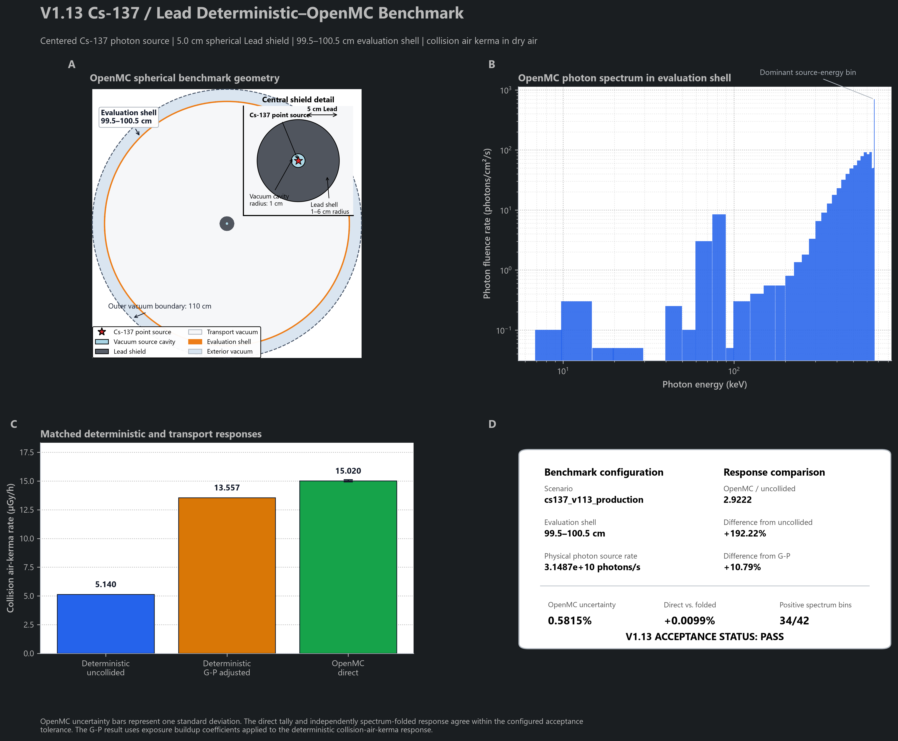
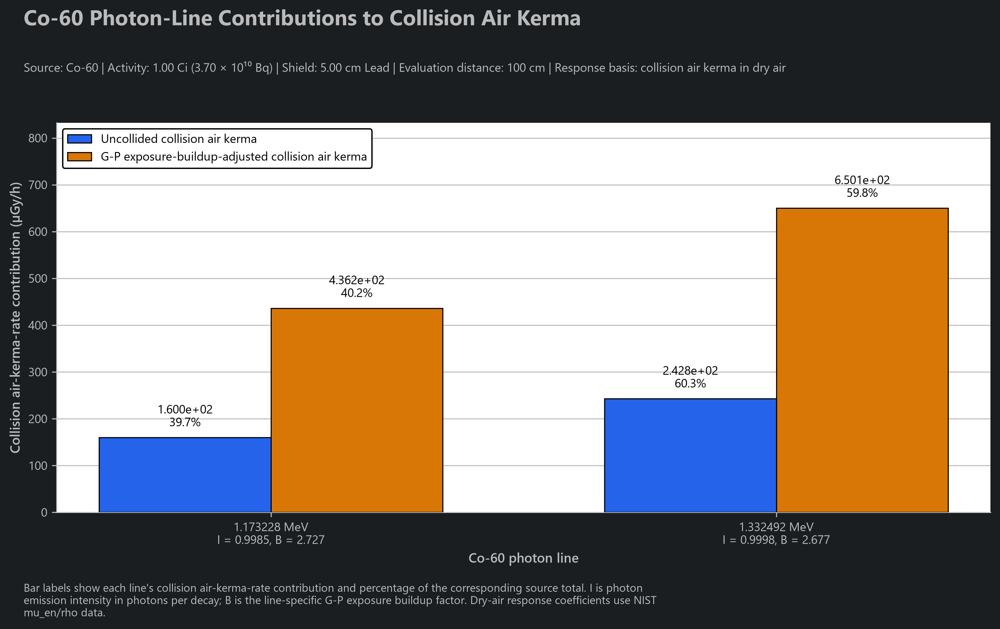

# Shielding Attenuation Simulator

A validated Python photon-shielding analysis and engineering design tool using NIST XCOM attenuation data, isotope photon-source models, explicit dry-air collision-air-kerma response quantities, G-P exposure buildup factors, engineering constraints, Pareto analysis, reproducible JSON scenarios, concentric spherical geometry, and matched OpenMC photon-transport benchmarking.

## Overview

The Shielding Attenuation Simulator models photon attenuation and radiation-response quantities from an isotropic point source through shielding materials.

The project began as a Java Beer-Lambert attenuation calculator and has developed into a modular Python shielding-analysis workflow capable of:

- calculating narrow-beam photon attenuation;
- modeling selected isotope photon lines;
- reporting explicit photon fluence and collision-air-kerma quantities;
- estimating single-layer exposure buildup;
- solving for minimum shielding thickness;
- comparing candidate materials;
- applying thickness, mass, and relative-cost constraints;
- ranking feasible designs under multiple objectives;
- classifying thickness-mass Pareto tradeoffs;
- visualizing engineering results and photon-line contributions;
- loading complete design scenarios from JSON;
- defining concentric spherical shielding geometry;
- constructing matched deterministic and OpenMC models from shared physical inputs;
- processing OpenMC statepoints into physical photon-fluence and collision-air-kerma rates;
- comparing deterministic uncollided, deterministic G-P-adjusted, and Monte Carlo responses;
- generating reproducible benchmark figures and release packages.

The current release is **V1.13**.

V1.13 is a benchmark-foundation release. It establishes one complete, quantity-matched deterministic/OpenMC calculation pathway but does not yet constitute broad validation across multiple materials, energies, or shielding depths.

## Current Capabilities

### Deterministic Photon Transport

- Beer-Lambert narrow-beam attenuation
- Single-layer and multilayer transmission
- NIST XCOM mass attenuation data
- Log-log attenuation-coefficient interpolation
- Linear attenuation coefficients
- Mean-free-path calculations
- Inverse-square point-source spreading
- Manual monoenergetic photon sources
- Selected isotope photon lines
- Line-by-line isotope calculations
- Homogeneous single-material G-P exposure buildup for supported materials
- Fixed-thickness shielding calculations
- Target-driven minimum-thickness calculations

### Radiation-Response Quantities

The simulator separates photon-number quantities from energy-weighted radiation responses.

Current response quantities include:

- uncollided photon fluence rate in photons/cm²/s;
- photon energy fluence rate in MeV/(cm²·s);
- uncollided collision air-kerma rate in Gy/s and µGy/h;
- G-P exposure-buildup-adjusted collision air-kerma rate in Gy/s and µGy/h;
- OpenMC energy-resolved photon fluence rate;
- OpenMC direct collision-air-kerma response;
- OpenMC spectrum-folded collision-air-kerma response.

The deterministic response sequence is:

```text
Activity and emission intensity
            ↓
Photon emission rate
            ↓
Inverse-square spreading
            ↓
Beer-Lambert transmission
            ↓
Uncollided photon fluence rate
            ↓
Photon energy fluence rate
            ↓
Dry-air μen/ρ response folding
            ↓
Uncollided collision air-kerma rate
            ↓
Optional G-P exposure-buildup adjustment
```

The OpenMC response sequence is:

```text
Shared physical scenario
            ↓
OpenMC spherical model
            ↓
Fixed-source photon transport
            ↓
Energy-resolved and direct-response tallies
            ↓
Evaluation-shell volume normalization
            ↓
Physical source-rate scaling
            ↓
Photon fluence rate and collision air kerma
            ↓
Deterministic/OpenMC comparison
```

The canonical internal air-kerma-rate unit is:

```text
Gy/s
```

The primary engineering display unit is:

```text
µGy/h
```

The dry-air response calculation uses a 38-entry NIST mass energy-absorption coefficient table from 0.001 to 20 MeV. The implementation preserves the duplicate argon K-edge entries and prevents interpolation across the zero-width absorption-edge interval.

G-P exposure buildup is applied only to compatible collision-air-kerma responses. It is not interpreted as a correction to photon-number fluence.

### Shielding Design and Optimization

Supported design targets include:

- transmission targets;
- reduction-factor targets;
- uncollided photon-fluence-rate targets;
- collision-air-kerma-rate targets.

Design capabilities include:

- analytical and numerical minimum-thickness solutions;
- bracket scanning and bisection;
- support for initially nonmonotonic buildup-adjusted responses;
- single-material comparison;
- engineering constraint filtering;
- minimum-thickness optimization;
- minimum-mass optimization;
- minimum-relative-cost optimization;
- weighted balanced optimization;
- explicit `ELIGIBLE`, `REJECTED`, and `FAILED` design states;
- thickness-mass Pareto classification.

Air-kerma target calculations use strict buildup behavior. When G-P exposure buildup is required, every contributing photon line must have a valid buildup result. Unsupported materials or out-of-domain optical thicknesses are reported as `FAILED` rather than silently substituted with an uncollided design.

### Reproducible Scenarios and Geometry

Complete shielding problems can be stored as human-readable JSON:

```text
Scenario JSON
      ↓
Validated ShieldingScenario
      ↓
Shared physical source and geometry
      ↓
Deterministic or OpenMC backend
```

A scenario can define:

- calculation mode;
- source type and activity;
- isotope or manual photon-source specification;
- concentric spherical geometry;
- source-cavity radius;
- ordered shielding layers;
- evaluation radius;
- response target;
- candidate materials;
- engineering constraints;
- optimization objective;
- optional balanced weights;
- deterministic calculation settings.

The scenario layer supports both material-optimization problems and fixed-shield response calculations.

OpenMC execution settings are stored separately from the physical scenario. Particle count, batch count, random seed, transport options, tally energy bins, statepoint batches, and outer-boundary settings can therefore change without redefining the physical shielding problem.

### OpenMC Benchmarking

V1.13 adds a reusable OpenMC photon-benchmark workflow with:

- scenario-driven spherical geometry;
- centered isotropic photon sources;
- vacuum source cavities;
- ordered spherical shielding shells;
- vacuum evaluation shells;
- continuous-energy photon transport;
- thick-target bremsstrahlung treatment;
- atomic relaxation;
- configurable photon cutoff energy;
- direct and energy-resolved tallies;
- automatic statepoint processing;
- shell-volume normalization;
- physical source-rate scaling;
- dry-air collision-air-kerma response folding;
- direct-tally uncertainty propagation;
- deterministic shell-volume averaging;
- direct-versus-folded consistency checks;
- deterministic-versus-OpenMC comparisons;
- reproducible JSON and CSV outputs;
- annotated geometry, spectrum, response, and summary figures;
- canonical benchmark release packaging;
- SHA-256 statepoint verification.

## Official V1.13 Deterministic–OpenMC Benchmark

The official V1.13 benchmark models:

- Source: Cs-137
- Activity: 1.00 Ci, or 3.70 × 10¹⁰ Bq
- Modeled photon energy: 0.661657 MeV
- Emission intensity: 0.851 photons/decay
- Physical photon source rate: 3.1487 × 10¹⁰ photons/s
- Source-cavity radius: 1.0 cm
- Shield material: Lead
- Lead density: 11.34 g/cm³
- Shield thickness: 5.0 cm
- Lead-shell radii: 1.0–6.0 cm
- Evaluation-shell center radius: 100.0 cm
- Evaluation-shell radii: 99.5–100.5 cm
- Outer vacuum-boundary radius: 110.0 cm
- OpenMC particles per batch: 50,000
- OpenMC batches: 100
- Total source histories: 5,000,000
- Photon-energy bins: 42
- Response quantity: shell-volume-averaged dry-air collision air-kerma rate

The official physical scenario is:

```text
scenarios/cs137_v113_production.json
```

The corresponding OpenMC settings profile is:

```text
config/openmc/v113_production.json
```

### Benchmark Results

| Calculation | Collision air-kerma rate |
|---|---:|
| Deterministic uncollided | 5.139917558 µGy/h |
| Deterministic G-P adjusted | 13.557461191 µGy/h |
| OpenMC direct | 15.019807382 µGy/h |
| OpenMC spectrum folded | 15.021290068 µGy/h |

Additional OpenMC results:

```text
Total photon fluence rate:     1480.394929639 photons/cm²/s
Direct standard deviation:        0.087341811 µGy/h
Direct relative uncertainty:       0.581511%
Direct-versus-folded difference:   0.009872%
```

The configured direct-versus-folded tolerance is 2%. The configured required and preferred relative-uncertainty limits are 5% and 2%, respectively. All three acceptance checks pass.

The observed Monte Carlo response ratio relative to the deterministic uncollided calculation is:

```text
2.922188
```

The deterministic G-P response captures most of the scattered contribution but remains approximately 10.8% below the direct OpenMC result for this benchmark.

This ratio is specific to the V1.13 source, material, thickness, geometry, response quantity, and data configuration. It is not a general-purpose buildup coefficient.



### Benchmark Release Package

The canonical release package is:

```text
results/v1.13/cs137_lead_benchmark/
```

It contains:

- authoritative physical-scenario input;
- authoritative OpenMC settings input;
- processed OpenMC response data;
- energy-resolved photon-spectrum data;
- deterministic/OpenMC comparison data;
- compact CSV result summary;
- raw OpenMC geometry slices;
- annotated geometry figure;
- separate spectrum, response, and summary panels;
- combined four-panel benchmark figure;
- reconstructed run manifest;
- technical benchmark README.

The preserved production statepoint is:

```text
results/v1.13/production_run/
cs137_v113_production__v113_production/
statepoint.100.h5
```

Its SHA-256 digest is:

```text
3D8342114E7F00A1B590CF1CF77EE9D95B2259E7C576EFB52C956E03B7695562
```

The processing copy under `production_recovery` is byte-for-byte identical. The raw statepoint is referenced by the compact release package rather than duplicated inside it.

## Official V1.12 Engineering Case

The official V1.12 deterministic design scenario models:

- Source: Cs-137
- Activity: 1.00 Ci, or 3.70 × 10¹⁰ Bq
- Selected photon line: 0.661657 MeV
- Emission intensity: 0.851 photons/decay
- Source-cavity radius: 0 cm
- Evaluation radius: 100 cm
- Target: G-P exposure-buildup-adjusted collision air-kerma rate ≤ 1 µGy/h
- Maximum shielding thickness: 20 cm
- Maximum mass per area: 120 g/cm²
- Objective: minimum mass per area
- Candidate materials: nine
- G-P exposure buildup: required
- Numerical search limit: 100 cm

The optimizer selects **Lead**:

```text
Required thickness: 7.180648660 cm
Mass per area:      81.428555808 g/cm²
Final adjusted K:   0.999999991 µGy/h
Response ratio:     3.570781 × 10⁻⁴
Eligible designs:   Lead and Tungsten
Selected objective: Minimum mass per area
```

The complete candidate accounting is:

```text
2 eligible + 4 rejected + 3 failed = 9 materials
```

- Lead and Tungsten are eligible.
- Aluminum and Ordinary Concrete exceed both active engineering limits.
- Copper and Tin exceed the mass-per-area limit.
- Barite Concrete and Polyethylene lack validated G-P exposure-buildup data.
- Water cannot reach the required response within the 100 cm calculation range.

The official scenario file is:

```text
scenarios/cs137_air_kerma_reference.json
```

The earlier V1.10 photon-response reference scenario remains available for regression testing:

```text
scenarios/cs137_v110_reference.json
```

## Co-60 Photon-Line Contribution Figure

V1.12 includes a reproducible line-contribution figure for:

- 1.00 Ci Co-60;
- 5.00 cm Lead;
- 100 cm evaluation distance;
- two modeled photon lines;
- uncollided and G-P-adjusted collision-air-kerma contributions.

The validated source totals are approximately:

```text
Uncollided collision air-kerma rate:   402.829 µGy/h
G-P-adjusted collision air-kerma rate: 1086.362 µGy/h
```



The figure demonstrates that photon-line contributions depend on energy, attenuation, dry-air response coefficient, emission intensity, and buildup factor. Contribution cannot be inferred from emission intensity alone.

## Installation

Python 3.10 or newer is recommended.

Create a virtual environment:

```bash
python -m venv .venv
```

Activate it on Windows PowerShell:

```powershell
.\.venv\Scripts\Activate.ps1
```

Activate it on macOS or Linux:

```bash
source .venv/bin/activate
```

Install the Python dependencies:

```bash
python -m pip install -r requirements.txt
```

The deterministic simulator, processed-result tools, benchmark plotting, and release packaging run in the local Python environment.

OpenMC transport is run separately through an OpenMC installation or container with suitable continuous-energy photon data.

## Running the Deterministic Simulator

From the repository root:

```bash
cd src
python main.py
```

The command-line interface supports:

1. fixed-thickness shielding calculations;
2. minimum-thickness shielding design;
3. material comparison;
4. constraint-based material optimization.

Each mode allows the user to select the intended response quantity:

- uncollided photon fluence rate;
- collision air-kerma rate.

Exposure buildup is not applied to photon-number fluence. The G-P prompt is shown only for compatible collision-air-kerma calculations.

## Running Reproducible Scenarios

Run the official V1.12 air-kerma design scenario:

```bash
python examples/run_scenario.py
```

Run a specific deterministic scenario:

```bash
python examples/run_scenario.py scenarios/cs137_air_kerma_reference.json
```

Run the historical V1.10 regression scenario:

```bash
python examples/run_scenario.py scenarios/cs137_v110_reference.json
```

The scenario output reports:

- scenario metadata;
- target quantity and units;
- buildup treatment;
- candidate counts;
- selected material;
- required thickness;
- mass per area;
- final response;
- response ratio;
- selection reason;
- failed-candidate explanations;
- warnings.

## Running the V1.13 OpenMC Benchmark

### Launching OpenMC with Docker

A typical PowerShell launch command is:

```powershell
docker run --rm -it `
    -v "${PWD}:/workspace" `
    -w /workspace `
    openmc/openmc:latest
```

The OpenMC environment must have access to a compatible continuous-energy photon-data library.

### Running a Fresh Production Calculation

Inside the OpenMC environment:

```bash
python examples/openmc_v113_production_run.py
```

This constructs the OpenMC model from the shared scenario and production settings, runs the fixed-source transport calculation, and processes the resulting statepoint.

A fresh five-million-history production run is not required to inspect or verify the packaged V1.13 release because the authoritative production statepoint has already been preserved and hashed.

### Processing the Preserved Production Statepoint

The recovery-processing workflow is available through:

```bash
python examples/openmc_v113_process_production_recovery.py
```

This processes the preserved production statepoint without rerunning transport.

### Generating Raw Geometry Images

Inside the OpenMC environment:

```bash
python examples/generate_v113_geometry_plots.py
```

The raw geometry images are written under:

```text
results/v1.13/geometry_plot/
```

## Running Validation and Release Checks

Run the complete deterministic and regression validation suite:

```bash
python src/validation_runner.py
```

Expected final message:

```text
All validation tests passed.
```

Validate the processed V1.13 benchmark records and plot-ready data:

```bash
python examples/check_v113_benchmark_plot_data.py
```

Regenerate the V1.13 annotated geometry and benchmark figures:

```bash
python examples/generate_v113_benchmark_figure.py
```

Reassemble and verify the canonical release package:

```bash
python examples/package_v113_release.py
```

The release-packaging script:

- verifies the physical scenario and settings profile;
- verifies agreement between processed result records;
- verifies the production statepoint and processing copy by SHA-256;
- copies authoritative inputs and processed outputs;
- copies the official figures;
- generates `comparison_summary.csv`;
- generates the reconstructed recovery manifest;
- refuses to overwrite a different existing artifact.

V1.13 validation and release checks cover:

- fixed-shield scenario validation;
- shared deterministic/OpenMC geometry inputs;
- OpenMC settings validation;
- source-rate normalization;
- evaluation-shell construction;
- tally configuration;
- statepoint tally extraction;
- shell-volume normalization;
- physical source-rate scaling;
- energy-resolved spectrum processing;
- direct collision-air-kerma response processing;
- spectrum-folded response reconstruction;
- Monte Carlo uncertainty reporting;
- deterministic shell-volume averaging;
- deterministic uncollided comparison;
- deterministic G-P comparison;
- direct-versus-folded acceptance checks;
- benchmark plot-data validation;
- release-artifact verification;
- V1.12 and earlier regression behavior.

## Generating Figures

Generate the V1.10 engineering-design figure set:

```bash
python examples/generate_v110_figures.py
```

This creates PNG and SVG files under:

```text
docs/figures/v1.10/
```

The figures cover:

- material thickness, mass, and relative cost;
- engineering constraint feasibility;
- thickness-mass Pareto tradeoffs;
- detector response versus Lead thickness.

Generate the V1.12 Co-60 line-contribution figure:

```bash
python examples/generate_v112_line_contribution_figure.py
```

This creates PNG and SVG files under:

```text
docs/figures/v1.12/
```

Generate the V1.13 deterministic–OpenMC benchmark figure set:

```bash
python examples/generate_v113_benchmark_figure.py
```

This creates PNG and SVG files under:

```text
docs/figures/v1.13/
```

The V1.13 figure set includes:

- annotated OpenMC spherical geometry;
- energy-resolved photon spectrum;
- deterministic and OpenMC response comparison;
- benchmark metadata and acceptance summary;
- combined four-panel benchmark figure.

## Project Structure

```text
shielding-attenuation/
├── config/
│   └── openmc/
│       └── v113_production.json
├── docs/
│   ├── architecture/
│   ├── figures/
│   │   ├── v1.10/
│   │   ├── v1.12/
│   │   └── v1.13/
│   └── validation reports/
├── examples/
│   ├── check_v113_benchmark_plot_data.py
│   ├── generate_v110_figures.py
│   ├── generate_v112_line_contribution_figure.py
│   ├── generate_v113_benchmark_figure.py
│   ├── generate_v113_geometry_plots.py
│   ├── openmc_smoke_test.py
│   ├── openmc_v113_process_production_recovery.py
│   ├── openmc_v113_production_run.py
│   ├── package_v113_release.py
│   └── run_scenario.py
├── results/
│   └── v1.13/
│       ├── cs137_lead_benchmark/
│       ├── geometry_plot/
│       ├── production_recovery/
│       └── production_run/
├── scenarios/
│   ├── cs137_air_kerma_reference.json
│   ├── cs137_v110_reference.json
│   └── cs137_v113_production.json
├── src/
│   ├── air_response.py
│   ├── air_response_library.py
│   ├── air_response_models.py
│   ├── air_response_plots.py
│   ├── attenuation and source modules
│   ├── buildup modules
│   ├── geometry_models.py
│   ├── OpenMC benchmark plot-data and plotting modules
│   ├── OpenMC model and tally builders
│   ├── OpenMC response and statepoint-processing modules
│   ├── OpenMC result and settings I/O
│   ├── optimization modules
│   ├── plotting modules
│   ├── scenario_io.py
│   ├── scenario_models.py
│   ├── scenario_runner.py
│   ├── target_models.py
│   ├── thickness_calculator.py
│   ├── unit_conversions.py
│   └── validation_runner.py
├── CHANGELOG.md
├── LICENSE
├── README.md
└── requirements.txt
```

## Current Limitations

- Photon emission is modeled as an isotropic point source.
- Extended-source geometry and source self-attenuation are not modeled.
- Beer-Lambert attenuation represents only the narrow-beam uncollided component.
- G-P exposure buildup is an engineering response approximation rather than explicit scattered-particle transport.
- G-P exposure buildup currently supports one homogeneous shielding material at a time.
- Deterministic multilayer attenuation is supported, but deterministic multilayer buildup is not claimed.
- G-P calculations are limited to supported materials and optical thicknesses no greater than 40 MFP.
- Barite Concrete and Polyethylene do not currently have validated G-P coefficient tables.
- Dry-air μen/ρ folding produces a collision-air-kerma-rate estimate, not effective dose, organ dose, ambient dose equivalent, or another regulatory dose quantity.
- The isotope library contains selected useful photon lines rather than complete decay spectra.
- Source encapsulation, air attenuation, detector-window response, and detector efficiency are not modeled.
- The current deterministic optimizer evaluates homogeneous single-material designs.
- The spherical geometry layer defines physical shell radii, but total spherical shield mass is not yet used by the current optimizer.
- Relative-cost indices are simplified comparative assumptions rather than market prices.
- V1.13 contains one matched Cs-137/Lead OpenMC benchmark and does not establish broad agreement across materials, energies, or shielding depths.
- The V1.13 benchmark uses one concentric spherical geometry, one shielding thickness, and one evaluation distance.
- The V1.13 production benchmark does not use variance-reduction methods.
- OpenMC results depend on the selected nuclear-data library, transport settings, tally definition, response coefficients, and statistical convergence.
- The observed V1.13 Monte Carlo buildup ratio is scenario-specific and is not a general-purpose buildup coefficient.
- Exact figure pixels may vary with operating system, Matplotlib version, rendering backend, and installed fonts.
- The software is intended for conceptual engineering analysis, education, and research development—not regulatory certification or safety-critical design approval.

## Documentation

Formal validation reports, architecture notes, figures, and technical benchmark records are available in the [`docs`](docs) and [`results`](results) directories.

Recent documentation includes:

- **V1.09:** Constraint-based material selection
- **V1.10:** Engineering visualization and Pareto analysis
- **V1.11:** Reproducible scenarios, spherical geometry, JSON validation, and OpenMC environment verification
- **V1.12:** Radiation-response quantities, dry-air collision-air-kerma calculations, and strict buildup semantics
- **V1.13:** Matched Cs-137/Lead deterministic–OpenMC benchmark, production uncertainty analysis, direct-versus-folded verification, and reproducible release packaging

The V1.13 benchmark technical report is:

```text
results/v1.13/cs137_lead_benchmark/README.md
```

V1.13 intentionally uses this benchmark report rather than a separate broad validation report. The first multi-case OpenMC validation report is planned for V1.14.

The complete development history is recorded in [`CHANGELOG.md`](CHANGELOG.md).

## Roadmap

Planned major milestones:

```text
V1.14  Compact single-layer OpenMC benchmark study and validation report
V1.15  Mass-aware and two-layer deterministic screening
V1.16  OpenMC layer-order and finalist verification
V1.17  Final Cs-137 shield-container design study
V1.18  Portfolio monograph and release package
V1.19  Optional GUI and extended research features
```

## Author

Developed by **Cormac Thomas**, B.S. Nuclear Engineering student at the University of New Mexico.

Primary interests include radiation effects, radiation-hardened electronics, shielding analysis, Monte Carlo transport, and national-security technology.

## Primary Technical References

- NIST XCOM Photon Cross Sections Database
- NIST X-Ray Mass Attenuation Coefficients for Dry Air
- ANS-6.4.3 gamma-ray exposure-buildup reference data
- OpenMC photon-transport documentation
- NuDat and IAEA nuclear-decay data resources